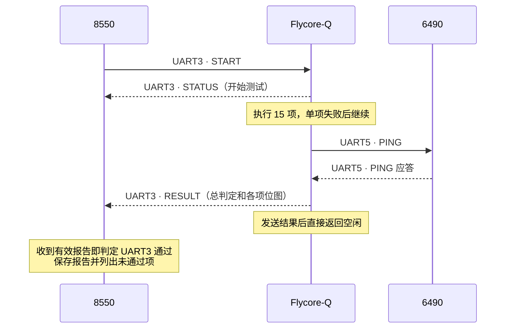

# Flycore-Q 入库检测协议

固件目标为 `amovlab_flycore_test`，PX4 板号为 `1218`。产测服务启动后独占两条串口，默认均为 115200、8N1、无流控。串口使用板上逻辑电平，工装应按实际板卡标注核对电平并连接 TX↔RX、RX↔TX 和 GND。

| 对端 | 飞控接口 | 对端 MAVLink sysid/compid | 飞控参数 |
|---|---|---|---|
| 8550 | UART3 / `/dev/ttyS1` | 2/191 | `FQ_8550_BAUD`、`FQ_8550_SYS`、`FQ_8550_COMP` |
| 6490 | UART5 / `/dev/ttyS3` | 3/191 | `FQ_6490_BAUD`、`FQ_6490_SYS`、`FQ_6490_COMP` |

飞控 sysid/compid 为 1/1。参数修改在重启后生效。支持的波特率为 9600、19200、38400、57600、115200、230400、460800、921600。工装应在独立台架上使用这些专用链路。

## 8550 工位

1. 8550 在飞控空闲时发送一次 `FLYCORE_TEST_START`。每次接受指令都会从头执行全测。
2. 飞控通过 `FLYCORE_TEST_STATUS` 回复已接受、正在测试或忙。执行检测或发送报告期间，新的开始指令会收到忙状态。
3. 飞控发送一次 `FLYCORE_TEST_RESULT` 后直接回到空闲。8550 收到有效报告后保存结果，并判定 UART3 双向通信通过。报告接收超时则由 8550 记录结果未知。排查结束后发送新的开始指令即可复测。
4. 绿灯目视记录和 USB 烧录校验由各自工位独立保存。

8550 给本板发送 `START` 并收到其 `RESULT`，即验证 UART3 的两个方向。这个判定由 8550 单独记录，适用于全测通过和全测未通过两种报告。

6490 在 UART5 上应答标准 MAVLink `PING`（ID 4）。应答回显请求的 `time_usec` 和 `seq`，目标填请求方的系统及组件 ID。飞控每次等待 1 秒，最多尝试 3 次。UART5 检测结果随报告发给 8550。



排查完成后，8550 再发相同的 `START` 即可从头全测。

| 结果位 | 测试 |
|---|---|
| 0、1、2、3 | UART2、UART8、UART6、UART7 TX/RX 硬件回环 |
| 4、5 | UART4 RTK、UART5 6490 |
| 6、7、8 | SPI1 BMI088、SPI2 ICM42688P、SPI4 FRAM |
| 9 | PWM 1–8 输出动作 |
| 10、11 | CAN1→CAN2、CAN2→CAN1 |
| 12、13 | I²C1、I²C4 外接 BMI088 |
| 14 | SD 持久写入及读回 |

`executed_mask` 的位表示执行过，`passed_mask` 的位表示通过。15 项连续使用第 0～14 位，两张位图都为 `0x7FFF` 时全测通过。第 15 位是 16 位字段的未使用高位，始终为 0。进度消息的 `item` 使用同一套位序，255 表示当前状态不对应具体项目。

新版将原 UART3 空位移除，SPI1 到 SD 卡的位号统一前移一位。8550 需与飞控固件同步更新结果位和进度项映射。

## 模拟对端

在仓库根目录生成 Python 编解码库。固件构建会从同一 XML 生成 C 库。主机需要安装 `pyserial`。

```sh
python3 protocol/flycore_incoming_test/generate.py \
  --definitions src/modules/mavlink/mavlink/message_definitions/v1.0 \
  --pymavlink-root src/modules/mavlink/mavlink \
  --language Python3 --output /tmp/flycore-test/flycore_test.py
PYTHONPATH=/tmp/flycore-test python3 protocol/flycore_incoming_test/mock_peers.py \
  --station /dev/ttyUSB0 --responder /dev/ttyUSB1 \
  --board-key flight-controller-serial
```

可单独使用 `--responder` 启动 6490 模拟端。每次重新运行工位命令都会发起新一轮检测。真实工装仍需提供回环连接、RTK、CAN 互连、外接 BMI088、8 路绿灯和 SD 卡。

## Linux 主机协议回归

在已初始化 MAVLink 子模块的 Linux PX4 开发环境中运行。需要 `g++`、Python 3 和 `pyserial`。

```sh
python3 protocol/flycore_incoming_test/tests/test_protocol.py -v
```

测试构建实际的飞控串口服务与检测调度代码，通过伪终端和模拟外设验证结果位图、PING 重试、忙状态、本地互斥和故障恢复后的复测。物理接口与外设由真机工装验收。
